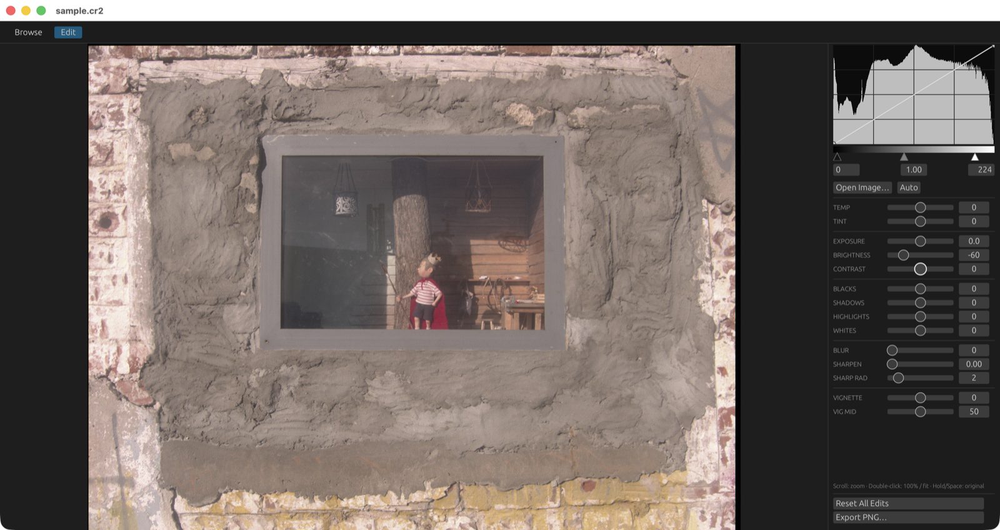

# Image Processor

A fast GPU image editor in Rust — wgpu compute shaders + egui. Every adjustment
runs as a compute pass on the GPU, so editing stays real-time even on large
images.



## Features

- **Browse / Edit tabs** — folder thumbnail browser (background-threaded
  loading) and a full editor; click a thumbnail to edit it
- **Formats** — PNG, JPEG, TIFF, BMP, WebP, GIF, and camera RAW
  (DNG, CR2, CR3, NEF, ARW, ORF, RW2, RAF, PEF, …) via rawler
- **Fast browsing** — grid thumbnails for RAW files come from the embedded
  JPEG preview via [`jpgfromrawlib`](https://github.com/ioma8/jpgfromrawlib),
  so browsing stays fast. Opening a RAW for editing always develops the sensor
  data; the preview is never used as the editor image
- **RAW development** — RAWs auto-develop on open through one universal path
  for every supported camera: rawler's 16-bit sensor decode, auto-levels,
  a hue-preserving S-curve over a local-tone base, and a small learned metering
  rule (one exposure gain and contrast offset from the frame's own statistics;
  coefficients baked in, no model file at runtime). No camera-manufacturer
  branch and no per-camera look. Camera JPEGs and embedded previews never feed
  the developed image. Checked against 18 manufacturers
  (Canon, Fuji, Nikon, Sony, Olympus, Panasonic, Pentax, Samsung, Leica,
  Hasselblad, Phase One, …) in `datasets/raw-samples`. See
  [RAW development](docs/raw-development.md) for the complete pipeline
- **Adjustments** — white balance (temp/tint), exposure (stops),
  brightness (Capture One-style midtone bias), contrast (logistic S-curve),
  blacks/shadows/highlights/whites tonal zones, box blur, unsharp mask,
  vignette — all hue-preserving (computed on luminance)
- **16-bit pipeline** — the GPU editing pipeline runs on 16-bit integer input
  and 16-bit half-float working textures (falling back to half-float input on
  devices without the 16-bit-norm feature); RAW development feeds the editor
  as 16-bit gamma-encoded RGBA, and export writes 16-bit PNGs
- **Levels** — draggable black/gamma/white handles under the live
  GPU-computed luminance histogram
- **Curves** — Photoshop-style: click the histogram to add points,
  natural cubic spline, applied as a 256-entry LUT
- **Auto** — one-click white balance, levels, contrast,
  shadows/highlights and vibrance chosen from the photo's own statistics
  (`src/auto.rs`; see `docs/auto-enhance.md`)
- **Reference look transfer** — CanonCGT canonicalizes the target's existing
  exposure/illumination and restylizes it with a finished reference's grade as
  one smooth 33³ LUT; the self-supervised checkpoint uses a 448px intermediate
  to preserve the canonicalized color mixtures before restyling, while a
  constrained profile model and approved edits provide a safe fallback and
  personalization for RAW or standard images
- **Export** — `Export…` (or ⌘/Ctrl+E): JPEG at a chosen quality or 16-bit
  PNG, optionally limited to a longest side, always written as the *crop* and
  at the size the dialog reports. Picks (or the whole folder view) go out to a
  folder in one pass, one image per frame, each rendered from its own saved
  edits
- **Print** — `Print…` beside Export: printer, the printer's own paper sizes,
  orientation, quality, copies, fit-to-page, and a preview of the sheet with
  the crop on it. Sends the crop through CUPS (`lp`) rather than the system
  sheet, so no AppKit session under the event loop. See
  [Printing](docs/print.md)
- **Persistent edits** — every image's edit state is saved to SQLite
  (`~/.image-processor/edits.db`) and restored when reopened;
  Reset All Edits reverts to defaults
- **Retouch brush** — a healing brush in the right panel; click the photo to
  heal a spot and the tool finds a matching patch of the same image to copy
  over it, blended and colour-corrected so the join disappears. Make the brush
  bigger than the blemish. `[` / `]` resize it (the physical keys, so the Czech
  `ú` / `)` layout works), right-click a dab to delete it. Dabs are a separate,
  removable layer in the edit state, so they compose with later slider changes
  and survive reopening. See [Retouch brush](docs/retouch.md)
- **Culling** — 1–5 star ratings, pick/reject flags (P/X), color labels
  (6–9), saved in SQLite independently of edits; badges in the grid and
  filmstrip
- **Filmstrip & navigation** — Left/Right arrows move through the folder in
  Edit view (filmstrip at the bottom) and Browse (grid selection, Enter opens)
- **Filter & sort** — show all/picks/rejects/unflagged, minimum star rating,
  sort by name or date
- **Bulk file ops** — trash rejects, move rejects to a folder, copy picks to
  a folder; SQLite rows follow moved/copied files
- **Export** — save the processed result as PNG

## Run

```bash
cargo run --release                  # empty start
cargo run --release -- photo.cr2     # open an image
cargo run --release -- ~/Pictures    # browse a folder
```

## Editor shortcuts

- Trackpad pinch or ⌘/Ctrl-scroll: zoom · two-finger scroll or drag: pan
  · double-click: 100% / fit
- Hold mouse or Space: show original
- 1–5: rate · 0: clear rating · P: pick · X: reject · 6–9: color label
- Left/Right: previous/next image · Enter (Browse): open selected
- ⌘/Ctrl+Z: undo · ⌘/Ctrl+Shift+Z (or Ctrl+Y): redo — per image, in memory
- ⌘/Ctrl+E: export — [details](docs/undo-and-export.md); `Print…` prints the crop
- Double-click a slider: reset it
- Crop: `⛶ Crop` in the right panel arms the crop tool; drag the corners or
  edges, or inside to move it — [details](docs/crop.md)
- Curves: click to add a point, right-click or drag out to remove,
  double-click to reset
- Retouch: click to heal a spot, `[` / `]` to size the brush (matched on the
  physical keys, so the Czech `ú` / `)` layout works), right-click a dab to
  delete it
